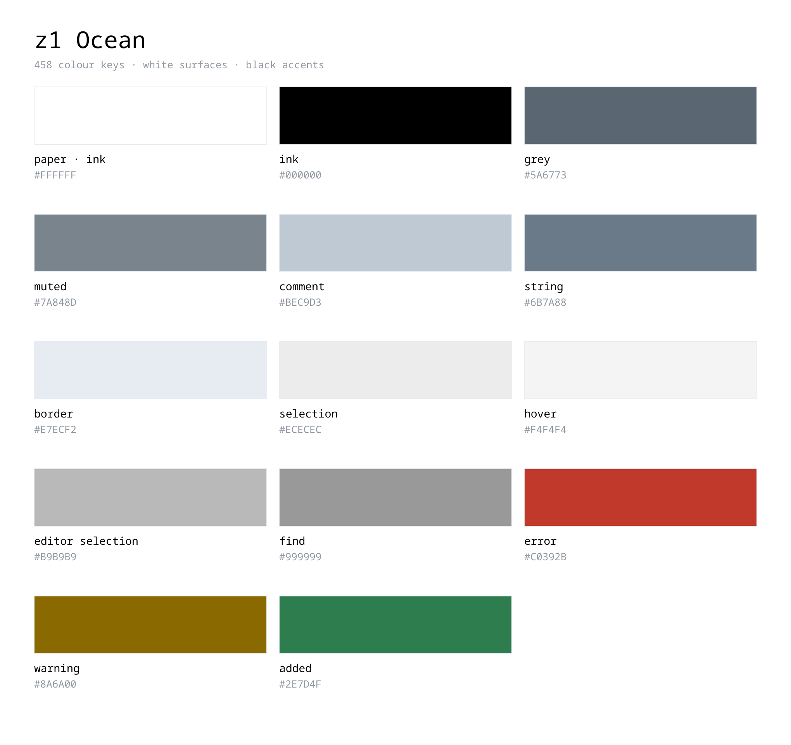
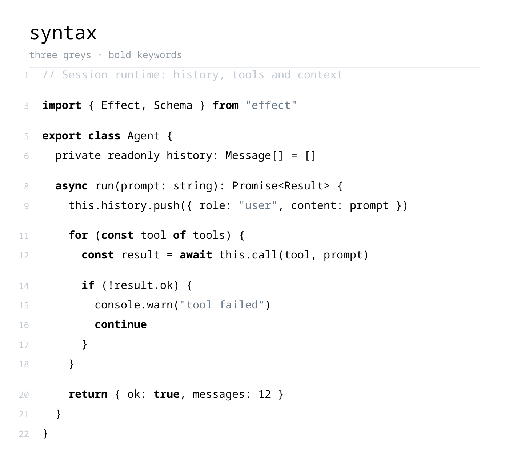

<div align="center">


# z1 theme

**White surfaces. Black accents. No hue.**

[**⬇ Download**](../../releases/latest)

</div>

<br>



<br>



<br>

## Themes

| Theme | UI | Character |
| --- | --- | --- |
| **z1 Ocean** | light | white surfaces, black accents, no hue |
| **z1 Default** | dark | neutral dark, white accents |
| **z1 Soft** | dark | the same, one step lighter |

## Install

```bash
code --install-extension z1-theme-1.0.0.vsix
```

Then `Ctrl+K Ctrl+T` and pick a theme.

## What Ocean is

| | |
| --- | --- |
| Surfaces | `#FFFFFF` — editor, sidebar, bars, panels, tabs, widgets |
| Text | `#000000` — 21:1 on white |
| Accent | black — the only accent, drawn as inverse blocks and rules |
| Hue | none in the interface; only error, warning and git states keep a colour |
| Keys | 458, covering every inheritance chain, so nothing falls back to a default |

## Rebuild the images

```bash
python3 script/make-images.py   # swatches and the syntax card, from themes/*.json
bun script/check-colors.ts      # fails if a colour reads blue
```

Slides are generated from the theme files themselves — no screenshots.

## License

MIT
