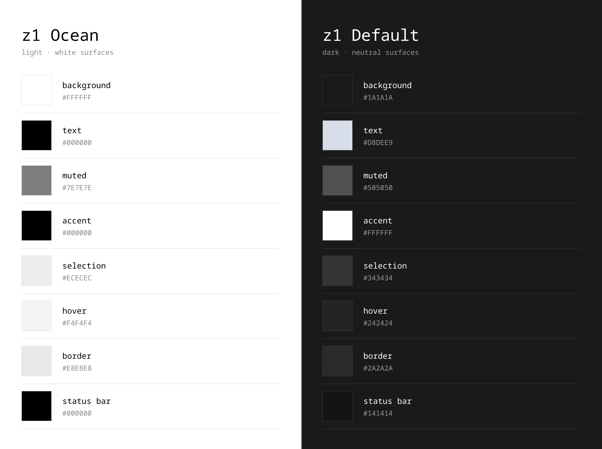

<div align="center">


# z1 theme

**White surfaces. Black accents. No hue.**

[**⬇ Download**](../../releases/latest)

</div>

<br>



## Install

```bash
code --install-extension z1-theme-1.0.0.vsix
```

Then `Ctrl+K Ctrl+T` and pick a theme.

## License

MIT
